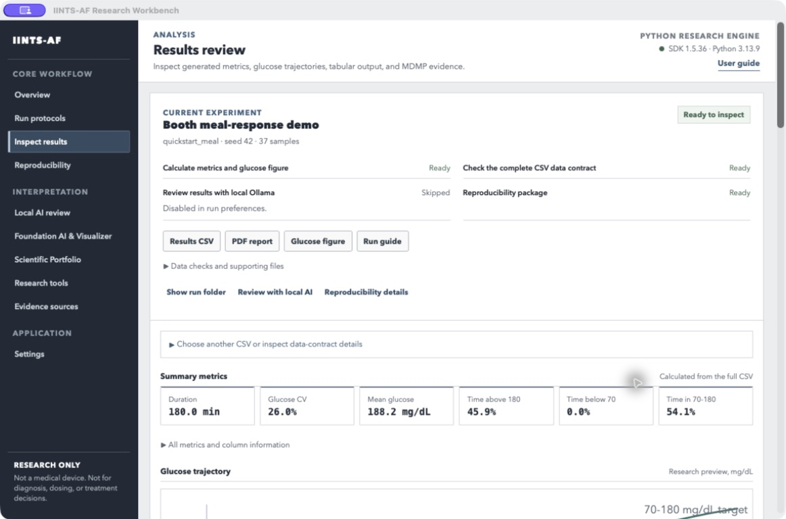
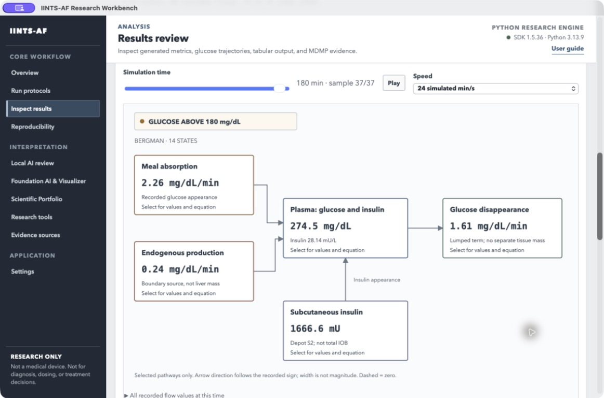

# IINTS-AF app: wat doet alles?

**Een Nederlandstalige wegwijzer voor Research Workbench beta 0.2.14 / SDK 1.5.37.**
De Engelse namen staan erbij zodat je de knoppen letterlijk kunt terugvinden.
Deze uitleg is gecontroleerd tegen de schermen en knoppen in de Tauri-code.
Het is geen bewijs dat iedere externe tool op jouw computer is geïnstalleerd.

## Begin hier: je hoeft niet alles te gebruiken

De app is een gereedschapskist, geen checklist die je helemaal moet afwerken.
Voor een gewone simulatie heb je maar drie schermen nodig:

**Overview → Run protocols → Inspect results.**

- **Overview:** kan de software op deze computer werken?
- **Run protocols:** welk experiment wil ik uitvoeren?
- **Inspect results:** wat kwam eruit?

**Local AI review** is optioneel. **Research tools** en **Foundation AI & Visualizer**
zijn aparte, geavanceerde onderzoeksonderdelen. Laat die eerst gerust met rust.
Ze hoeven niet gebruikt te worden om een normale run of een PDF te krijgen.

> Alles gaat hier over onderzoek en simulatie. Gebruik de app niet om echte
> insulinedoses, diagnoses of behandelingen te bepalen. Een groen vinkje betekent
> niet dat een model klinisch bewezen is.

## Je eerste run, zonder ingewikkelde keuzes

1. Open **Overview** en klik **Run diagnostics**. De Python-engine moet beschikbaar zijn.
2. Ontbreekt die? Ga naar **Settings → Install or update Python SDK**. Wacht tot
   de installatie klaar is en klik **Refresh versions**.
3. Ga naar **Run protocols**. Kies **Booth meal-response demo** voor een korte oefenrun.
4. Kies met **Choose folder...** een map. Laat **Seed** op `42` staan.
5. Laat **Prepare data checks and reproducibility files** aan. Laat **Add local AI review** eerst uit.
6. Klik **Run and prepare results** en wacht tot de voorbereiding klaar is.
7. Bekijk in **Inspect results** de glucosegrafiek, samenvatting en **PDF report**.

Klaar. Je hebt hiervoor geen eiwitstructuur, genetische variant, FMU of getraind AI-model nodig.
De maaltijd-demo is een stressvoorbeeld: glucose buiten de referentieband is niet automatisch een softwarefout.

## Welk scherm heb ik nodig?

| Ik wil... | Scherm | Eerst nodig? |
| --- | --- | --- |
| Controleren of alles klaarstaat | Overview | Ja |
| Een virtueel experiment starten | Run protocols | Ja |
| Grafieken, getallen en rapporten lezen | Inspect results | Ja |
| Vastleggen hoe een resultaat gemaakt is | Reproducibility | Voor deelbaar onderzoek |
| Een lokale AI om uitleg vragen | Local AI review | Nee |
| Een model met glucosepatronen trainen | Foundation AI & Visualizer | Alleen voor AI-onderzoek |
| Bestaand bewijs in een dossier verzamelen | Scientific Portfolio | Alleen voor een dossier |
| Eiwitten of externe rekenmodellen onderzoeken | Research tools | Alleen voor een specifieke onderzoeksvraag |
| Wetenschappelijke databanken vinden | Evidence sources | Als je bronnen zoekt |
| Mappen, AI-voorkeuren en updates regelen | Settings | Bij eerste gebruik en onderhoud |

## 1. Overview — staat de werkbank klaar?

Dit is je startscherm. Het rekent nog geen patiënt door.

| Knop | Wat gebeurt er? |
| --- | --- |
| **New experiment** | Gaat naar het scherm om een protocol te kiezen. |
| **Open latest result** | Opent een gevonden recent resultaat; voert het experiment niet opnieuw uit. |
| **Run diagnostics** | Controleert de Python-engine en beschikbare extra hulpmiddelen. Installeert die niet allemaal. |
| **Open default output folder** | Opent je standaardresultatenmap in de bestandsbeheerder. |
| **Install Python engine** | Start het installeren of herstellen van de Python-rekenlaag wanneer die ontbreekt. |
| **Open results** bij een recente run | Laadt dat specifieke eerdere resultaat. |
| **User guide** | Opent de uitgebreidere documentatie. |

**Engine** betekent hier: het programma dat werkelijk rekent. De Tauri-app is het
bedieningspaneel; de Python SDK doet de simulatie. Een ontbrekende optionele tool
zoals COPASI hoeft een gewone simulatie niet tegen te houden.

## 2. Run protocols — kies je experiment

Een **protocol** is een vooraf ingestelde proef: bijvoorbeeld een maaltijd of een
nachtelijk risicoscenario. Je hoeft de instellingen niet helemaal zelf op te bouwen.

| Protocol | Waarvoor bedoeld? |
| --- | --- |
| **Booth meal-response demo** | Kort kennismaken met een maaltijdreactie en de interface. |
| **Reference baseline day** | Een basisrun om simulatie en rapportage te bekijken; geen klinische gouden standaard. |
| **Doctor safety discussion** | Een gesimuleerde nachtelijke uitdaging bespreken met een deskundige. |
| **EUCYS experiment run** | Een maaltijdstresstest met geregistreerde veiligheidsgebeurtenissen laten zien. |
| **Pizza / delayed absorption** | Een aanname over vertraagde maaltijdopname onderzoeken. Niet iedere pizza of patiënt reageert zo. |
| **Jury walkthrough (full day)** | Een langere voorbeeldrun met bijbehorende bestanden bekijken. |

| Veld of knop | Betekenis |
| --- | --- |
| **Output folder / Choose folder...** | Waar de nieuwe run opgeslagen wordt. Iedere run krijgt een eigen submap. |
| **Seed** | Startgetal voor herhaalbare toevalsprocessen. Houd dit gelijk als je gecontroleerd wilt vergelijken; ook model, instellingen en versies moeten gelijk zijn. |
| **Prepare data checks and reproducibility files** | Laat na de simulatie ook controles en onderzoeksmetadata voorbereiden. Aan laten is de eenvoudigste route. |
| **Add local AI review** | Vraagt aanvullend uitleg aan de gekozen lokale Ollama-AI. Niet nodig voor de berekeningen. |
| **Run and prepare results** | Start de simulatie en de ingeschakelde naverwerking. Daarna opent het resultaat. |
| **Refresh protocols** | Vraagt de beschikbare protocollen opnieuw op bij de engine. |
| **Refresh history** | Zoekt eerdere runs opnieuw in de geselecteerde map. |
| **Open run folder** | Toont de bestanden van de run. |
| **Open report** | Opent het gegenereerde rapport als het beschikbaar is. |
| **Cancel run** | Stopt de lopende run. Een gedeeltelijk gevulde map is geen afgerond experiment. |
| **View results & 3D visualizer →** | Gaat naar de resultatenweergave. De naam betekent niet dat je een anatomisch 3D-patiëntmodel hebt gemaakt. |

**Run history** is je geschiedenis binnen de gekozen map. Een andere map kan dus
ook een andere of lege geschiedenis hebben. Opnieuw openen is iets anders dan opnieuw rekenen.

## 3. Inspect results — begrijp de uitkomst

Lees eerst de **glucosegrafiek**, dan de **samenvattende getallen**. De technische
tabel is vooral handig wanneer je iets wilt uitzoeken, niet als eerste stap.

### De knoppen en bestanden

| Knop of uitklapvak | Waarvoor gebruik je het? |
| --- | --- |
| **Results CSV / Open CSV** | Opent de tabel met de opgeslagen resultaten in een extern programma. |
| **PDF report** | Opent het leesbare rapport. |
| **Glucose figure** | Opent de afzonderlijke afbeelding van de glucosecurve. |
| **Run guide** | Opent `OPEN_FIRST.md`: het startpunt voor de bestanden van deze run. |
| **Show run folder** | Laat de hele resultatenmap zien. |
| **Review with local AI** | Gaat naar de optionele AI-uitleg voor deze data. |
| **Reproducibility details** | Gaat naar de onderzoeksmetadata en het pakket. |
| **Data checks and supporting files** | Toont extra certificaten, configuratie en ondersteunende bestanden. |
| **Choose another CSV or inspect data-contract details** | Klapt de bestandskeuze en aanvullende controles open. |
| **Choose CSV...** | Selecteert een bestaande resultaten-CSV; de preview laadt automatisch. |
| **Load preview** | Laadt het bestand, bijvoorbeeld nadat je het pad zelf hebt aangepast. |
| **Check MDMP data contract** | Controleert de data volgens het ingestelde datacontract. |
| **Open certificate** | Opent het resultaat van die datacontrole, niet een medische goedkeuring. |
| **All metrics and column information** | Toont de minder vaak benodigde getallen en kolominformatie. |
| **Show every technical column** | Toont ook technische CSV-kolommen in de preview. Verandert de brondata niet. |

### Wat betekenen de getallen?

| Term | In gewone taal |
| --- | --- |
| **Duration** | Hoeveel gesimuleerde tijd de run beslaat, niet hoe lang je computer bezig was. |
| **Mean glucose** | Het gemiddelde van de glucosewaarden. Een gemiddelde alleen kan pieken en dalen verbergen. |
| **Time in 70–180 / TIR** | Het berekende aandeel binnen de getoonde referentieband. Lees dit samen met duur, bemonstering en scenario. |
| **Time above 180 / TAR** | Het berekende aandeel boven de bovengrens. |
| **Time below 70 / TBR** | Het berekende aandeel onder de ondergrens. |
| **Glucose CV** | Relatieve spreiding: standaardafwijking gedeeld door gemiddelde, maal 100%. |
| **mg/dL** | Een eenheid voor glucoseconcentratie. Niet hetzelfde getal als mmol/L. |
| **Actual / model glucose** | De interne glucosewaarde van de simulator; bij een simulatie geen echte bloedmeting. |
| **Sensor / glucose to algorithm** | Wat het algoritme via het sensormodel te zien krijgt. Dit kan afwijken van de interne waarde. |
| **Prediction** | Een voorspelling, geen waargenomen toekomstige waarde. Controleer welk voorspellingsmodel gebruikt is. |
| **Safety event / override** | Een geregistreerde waarschuwing, aanpassing of blokkering. Meerdere tijdstappen kunnen over dezelfde situatie gaan. |

De samenvatting gebruikt de volledige CSV. De zichtbare tabel en grafiek kunnen
begrensde previews zijn. Een groene referentieband is geen bewijs dat de hele run
realistisch is. Evenmin bewijst een veiligheidsmelding dat een echte hypo voorkomen werd.

### Diagram en Physiology map: twee manieren om hetzelfde model te lezen

- **Diagram:** de gedetailleerde rekenblokken en verbindingen van het model.
- **Physiology map:** een eenvoudiger overzicht van geselecteerde processen.
- **Simulation time:** kies welke opgeslagen tijdstap je bekijkt.
- **Play / Pause / Speed:** blader automatisch door opgeslagen tijdstappen. Dit
  start geen nieuwe simulatie en verandert de data niet.
- **Show signal and effect states:** toont in Diagram ook interne regel- en
  effectvariabelen. Die zijn niet allemaal tastbare hoeveelheden in een orgaan.
- Klik een blok voor de waarden en vergelijking. **All recorded flow values at
  this time** toont de volledige beschikbare lijst voor dat tijdstip.

| Blok | Wat stelt het voor? | Wat is het niet? |
| --- | --- | --- |
| **Meal absorption** | Snelheid waarmee maaltijdglucose volgens het model beschikbaar komt. | De hoeveelheid voedsel die je op een plaatje ziet. |
| **Endogenous production / EGP** | Eigen glucoseproductie als berekende bronterm. | Een gemeten levervoorraad of levervolume. |
| **Plasma: glucose and insulin** | Concentraties in het centrale modelcompartiment. | Een anatomisch hartmodel. |
| **Subcutaneous insulin** | Een geselecteerd insulinedepot onder de huid in het model. | Alle actieve insuline of totale IOB. |
| **Glucose disappearance / peripheral exchange** | De opname-/uitwisselingsterm die dit specifieke model registreert. | Een bewezen afzonderlijke hoeveelheid spier- of vetweefsel. |

De pijlen tonen de richting van de geregistreerde stroom. Hun breedte vergelijkt
geen hoeveelheden. Ontbrekende waarden worden niet verzonnen. Verschillende
modellen, zoals Bergman en Hovorka, hebben verschillende interne variabelen.

### Wat is MDMP eigenlijk?

Denk aan een **kwaliteitscontrole van de datatabel**: zijn verwachte kolommen en
waarden aanwezig en voldoen ze aan het contract? Een ondertekend certificaat helpt
controleren of het bestand bij de verklaring hoort.

Het bewijst **niet** dat de fysiologie klopt, dat je AI betrouwbaar is of dat de
software medisch goedgekeurd is. Ook het historische label `clinical_grade` is
hier een datacontractlabel, geen klinische validatie. Deel nooit de private sleutel.

## 4. Reproducibility — hoe kan iemand je werk controleren?

Dit scherm maakt een pakket dat vastlegt **welke bestanden en instellingen bij je
experiment horen**. Met automatische voorbereiding bestaat al een basispakket.
Je kunt hier de onderzoeker- en licentiegegevens aanvullen.

| Veld of knop | Betekenis |
| --- | --- |
| **Completed run folder** | De map van het afgeronde experiment, niet een willekeurige verzameling CSV's. |
| **Package title** | Een herkenbare titel voor het pakket. |
| **Creator** | Naam van de maker/onderzoeker. |
| **ORCID** | Onderzoekers-ID; optioneel als je er geen hebt. |
| **Run-artifact licence** | Onder welke voorwaarden de bestanden gedeeld mogen worden. Laat `NOASSERTION` staan als je dit niet weet. |
| **Evidence source IDs** | Verwijzingen naar bronnen die werkelijk bij dit experiment horen. Geen willekeurige lijst om het wetenschappelijker te laten lijken. |
| **Create academic package** | Schrijft het lokale controlepakket. Publiceert niets automatisch. |
| **Open RO-Crate metadata** | Opent de gestructureerde beschrijving van bestanden en herkomst. |
| **Open audit** | Opent het controleverslag met aanwezige en ontbrekende onderdelen. |
| **Open review guide** | Opent de leesbare toelichting voor een beoordelaar. |

Een **checksum/hash** is een digitale vingerafdruk van een bestand. Een **audit**
is een controleverslag. Beide helpen bij traceerbaarheid, maar vervangen geen
wetenschappelijke beoordeling of toestemming om patiëntdata te delen.

## 5. Local AI review — uitleg vragen, niet opnieuw rekenen

Gebruik dit als je hulp wilt bij het lezen van een **al geladen resultaat**.
Het is een taalmodel voor toelichting, niet automatisch het model dat glucose voorspelt.

| Veld of knop | Betekenis |
| --- | --- |
| **Ollama model** | Welk lokaal taalmodel je gebruikt. Grotere modellen kosten vaak meer geheugen en tijd. |
| **Host** | Adres van je lokale Ollama-dienst. Laat normaal `http://127.0.0.1:11434` staan. |
| **Start local AI** | Probeert Ollama klaar te zetten en het geselecteerde model beschikbaar te maken; een modeldownload kan nodig zijn. |
| **Check connection** | Controleert of de dienst bereikbaar is. |
| **Refresh model list** | Vraagt de beschikbare modellen opnieuw op. |
| **Research question** | Je vraag over het gekoppelde resultaat. |
| **Analyze loaded result** | Stuurt de ondersteunde runcontext naar de lokale AI en toont de gefilterde uitleg. |

Een goede eerste vraag is: **“Vat deze run eenvoudig samen. Welke getallen moet ik
zelf controleren en wat kun je uit deze data niet afleiden?”**

**Deterministic SDK facts** zijn de berekende feiten. **AI review** is gegenereerde
tekst. De app kan onbewezen getallen of behandeladvies wegfilteren; soms blijft er
weinig tekst over. Dat is geen reden om de filters uit te zetten of de AI boven de
CSV te vertrouwen. De AI certificeert je resultaten niet.

## 6. Foundation AI & Visualizer — geavanceerd glucose-AI-onderzoek

**Overslaan als je alleen een simulatie wilt draaien.** Dit onderdeel leert patronen
uit CGM-data. De GlucoFM-methodereproductie is een eigen implementatie; het is niet
automatisch het officiële Google-model met officiële gewichten.

### Een lokaal model trainen

| Veld of knop | Betekenis |
| --- | --- |
| **Pretraining dataset / Choose dataset...** | Selecteer geschikte CGM-trainingsdata. Niet zomaar een PDF of screenshot. |
| **Pretraining output folder** | Eigen map voor modelbestanden en logs. |
| **Epochs** | Hoe vaak de training door de trainingsdata gaat. Meer is niet automatisch beter. |
| **Batch size** | Hoeveel voorbeelden tegelijk worden verwerkt; beïnvloedt het geheugengebruik. |
| **Pretrain local reproduction** | Start een echte training. Kan veel tijd en geheugen vragen. |

### Een getrainde representatie bekijken

| Veld of knop | Betekenis |
| --- | --- |
| **24-hour CGM CSV** | Glucosereeks die je wilt laten omzetten naar modelkenmerken. |
| **Trained GlucoFM checkpoint** | Het opgeslagen, compatibele getrainde model, bijvoorbeeld `glucofm_encoder.pt`. |
| **Glucose column / Timestamp column** | Kolomnamen, alleen aanpassen als automatische herkenning niet klopt. |
| **Extract trained 128D embedding** | Maakt 128 modelkenmerken uit de reeks. Dat zijn geen 128 organen of rechtstreeks interpreteerbare medische metingen. |
| **Comparable evaluation artifacts / Choose JSON files...** | Selecteer evaluatieresultaten die methodologisch vergelijkbaar zijn. |
| **Compare selected evidence** | Vergelijkt die geselecteerde evaluatiebestanden, niet willekeurige patiënten alsof de onderzoeken gelijk waren. |
| **Method schematic** | Toont hoe de methode opgebouwd is. Geen trainingsresultaat. |
| **Last embedding** | Toont de laatst berekende representatie. |
| **Held-out forecast evidence** | Toont beschikbare voorspellingsevaluatie; lees het label dat echte evaluatie van demonstratiedata onderscheidt. |

**Held-out** betekent apart gehouden voor evaluatie. Dezelfde patiënt of overlappende
vensters in training en test kunnen een te mooi resultaat geven. Lang trainen alleen
bewijst dus niet dat je model nieuwe patiënten goed voorspelt.

## 7. Scientific Portfolio — een dossier van bestaand bewijs

| Veld of knop | Betekenis |
| --- | --- |
| **Dossier output folder** | Waar het dossier komt. Gebruik een aparte map. |
| **Generate evidence dossier** | Verzamelt/indexeert beschikbare lokale bewijsbestanden. Maakt ontbrekende experimenten niet vanzelf. |
| **Open dossier** | Opent het leesbare dossier. |
| **Open manifest** | Toont welke onderdelen wel en niet aanwezig zijn. |
| **Reveal output folder** | Opent de map met het dossier. |

Controleer figuurbijschriften, bronnen en ontbrekende stukken voordat je dit aan een
jury geeft. Een fraai dossier is niet hetzelfde als een gevalideerd resultaat.

## 8. Research tools — losse specialistische gereedschappen

**Kies hier alleen een onderdeel als je weet welke onderzoeksvraag je ermee wilt
beantwoorden.** Een eiwit bekijken verandert niet vanzelf de glucoseberekening.
De sprongknoppen binnen dit scherm helpen je naar het gewenste onderdeel te gaan.

### A. Eiwitten bekijken: AlphaFold en de 3D-viewer

Doel: een voorspelde eiwitstructuur onderzoeken of illustreren.

| Knop | Wat doet die? |
| --- | --- |
| **Load molecule assets** | Laadt de beschikbare eiwitbestanden en kaarten. |
| **Open structural folder** | Opent de bijbehorende bestandenmap. |
| **View 3D** | Opent een draaibare weergave van de eiwitruggengraat. Niet een volledige moleculaire dynamicasimulatie. |
| **Reset view** | Zet de camera terug. Verandert het eiwit niet. |
| **Auto-rotate** | Laat alleen de weergave draaien. |
| **Close viewer** | Sluit de viewer. |
| **Open PNG** | Opent een statische afbeelding. |
| **Reveal mmCIF** | Toont het coördinatenbestand in de bestandsbeheerder. |
| **Generate PAE / Open PAE** | Haalt de foutschattingsmatrix op of opent de bestaande versie. |
| **AlphaFold entry** | Opent de officiële databankpagina. Hiervoor is internet nodig. |

**pLDDT** is een lokale betrouwbaarheidsscore van de structuurvoorspelling.
**PAE** geeft geschatte onzekerheid over relatieve posities van eiwitdelen.
Geen van beide vertelt rechtstreeks hoe ernstig diabetes is, hoe goed een medicijn
werkt of hoeveel insulinegevoeligheid een variant overlaat.

### B. Genomics multi-scale simulation

Doel: een expliciet ondersteund/aangenomen effect van een genetische variant als
simulatiescenario vergelijken. **Gene** is het gen, **Variant** de verandering.

- **Run genomics simulation:** start de scenariovergelijking.
- **Open genomics plot:** opent de gegenereerde figuur.

Lees altijd de bron en effectaanname in de output. Een variantnaam of een label
“pathogenic” bepaalt op zichzelf geen exact fysiologisch percentage. Een onbekende
variant mag niet als bewezen functioneel effect worden geïnterpreteerd. Dit is geen
persoonlijke genetische diagnose of patiëntkalibratie.

### C. Tissue-specific resistance stress test

Doel: onderzoeken hoe een algoritme reageert op verschillende **aannames** over
spier- en levergevoeligheid.

- **Muscle sensitivity %:** relatieve gevoeligheidsinstelling voor de spierkant.
- **Liver sensitivity %:** relatieve gevoeligheidsinstelling voor de leverkant.
- **Run tissue stress test:** voert de vergelijking uit.
- **Open tissue plot:** opent de figuur.

`100%` is de referentie-instelling van dit model, geen vastgestelde gezondheid van
een patiënt. `30%` is een simulatie-instelling, niet iets wat je uit een losse
expressiegrafiek of eiwitafbeelding mag afleiden.

### D. Mechanistic Reference Model Lab: SBML

Doel: een **apart vergelijkingsmodel met vergelijkingen** uitvoeren, bijvoorbeeld
om een berekening onafhankelijk te onderzoeken. Niet nodig voor standaardpresets.

| Veld of knop | Betekenis |
| --- | --- |
| **Local SBML file / Choose file...** | Een lokaal rekenmodel in `.xml` of `.sbml`, niet een resultatenbestand. |
| **Variables** | Welke modelvariabelen je wilt registreren. Gebruik namen die in het model staan. |
| **Model source URL / Model license** | Herkomst en gebruiksvoorwaarden vastleggen. |
| **Start / End** | Begin en einde in de tijdseenheid van het externe model. Niet automatisch minuten. |
| **Sample points** | Aantal gevraagde uitvoerpunten. |
| **Check engine** | Controleert de benodigde rekenbibliotheek. |
| **Inspect SBML** | Bekijkt de modelbeschrijving. |
| **Run reference model** | Voert het externe model uit. |
| **Open run folder / Open review report / Open reference CSV** | Opent respectievelijk bestandenmap, verslag of uitvoertabel. |

**libRoadRunner** is de rekenbibliotheek die dit model uitvoert. Vergelijk geen
waarden met IINTS-glucose voordat je variabelen en eenheden hebt gecontroleerd.

### E. Cross-scale Reference Labs

**Check all engines** controleert welke externe hulpmiddelen beschikbaar zijn.
Het voert niet alle onderzoeken uit en installeert niet alle programma's.

| Onderdeel | Wanneer nuttig? | Invoer en knoppen |
| --- | --- | --- |
| **COPASI** | Vragen zoals: op welke parameters reageert mijn model sterk? | Selecteer `.cps`; **Inspect tasks** bekijkt taken; **Run configured analysis** voert de ingestelde analyse uit; **Open latest bundle** opent de output. |
| **OpenCOR / CellML** | Een extern fysiologisch model inspecteren en controleren. | Selecteer `.cellml`/`.xml`; **Inspect CellML** bekijkt het bestand; **Validate with OpenCOR** vraagt validatie via OpenCOR; **Open latest bundle** opent de output. Validatie is niet hetzelfde als klinische juistheid of een volledige simulatie. |
| **FMI / FMPy** | Een extern apparaat-/fysisch model uitvoeren, bijvoorbeeld pompgedrag. | Selecteer `.fmu`; **Inspect FMU safely** inspecteert metadata; **Run trusted FMU** voert het model uit; **Open latest bundle / Open latest CSV** opent de resultaten. |
| **BindingDB** | Gepubliceerde meetgegevens over moleculaire binding zoeken. | Vul **UniProt accession**, **Affinity cutoff (nM)** en **Maximum records** in; **Fetch measured affinities** haalt records op; **Open latest bundle / Open affinity CSV** opent de bestanden. |

Overige velden:

- **Task override:** kiest bij COPASI een andere taak; alleen wijzigen als je de modeltaken kent.
- **Timeout seconds:** maximale wachttijd voor de opdracht, niet gesimuleerde tijd.
- **Output interval:** afstand tussen uitvoerpunten van het externe model.
- **Variables:** namen van gewenste uitvoervariabelen.
- **Start / End:** tijdsbereik in de eenheden van dat model.
- **UniProt accession:** de databankcode van een eiwit, niet de naam van een patiënt.
- **Affinity cutoff:** zoekfilter voor bindingsmetingen; geen doseeradvies.

**Let op de toestemmingsvakjes.** COPASI-taken kunnen naar externe bestanden
verwijzen. Een FMU kan uitvoerbare native code bevatten en is niet automatisch
veilig omdat hij uit een wetenschappelijke context komt. Een bestand kiezen is
niet hetzelfde als het vertrouwen en uitvoeren. Voer geen onbekende FMU zomaar uit.
Bindingsmetingen zoals Ki, Kd en IC50 zijn bovendien niet onderling uitwisselbaar
of rechtstreeks een modelparameter voor glucose.

## 9. Evidence sources — waar komt kennis vandaan?

Dit is de bronnenkast, niet de simulator.

| Veld of knop | Betekenis |
| --- | --- |
| **Load evidence connectors** | Laadt het overzicht van beschikbare koppelingen en bronnen. |
| **Search resources** | Zoekt op naam of onderwerp. |
| **Integration status** | Filtert op wat werkelijk geïmplementeerd is. |
| **Open portal** | Opent de officiële website. Importeert niet automatisch data. |
| **Open API docs** | Opent technische documentatie voor de koppeling. Meestal niet nodig als beginner. |

**Integrated** = een afgebakende koppeling bestaat. **Partially integrated** = een
deel bestaat. **Portal only** = een link. **Planned** = nog niet beschikbaar.
Geen van deze labels betekent dat de bron jouw simulatie heeft gevalideerd.

## 10. Settings — voorkeuren en onderhoud

| Veld of knop | Betekenis |
| --- | --- |
| **Default output folder** | Standaardmap voor nieuwe runs. Verplaatst oude resultaten niet. |
| **Default deterministic seed** | Standaardstartgetal voor nieuwe experimenten. |
| **Default Ollama model / Local Ollama host** | Voorkeur voor lokale AI-uitleg. |
| **Run environment diagnostics when the application starts** | Controleert de omgeving bij het openen. |
| **After each run** | Standaardkeuze voor automatische controles en optionele AI-review. |
| **Save settings** | Bewaart deze lokale voorkeuren. |
| **Restore defaults** | Zet voorkeuren terug; is geen knop om onderzoeksbestanden te verwijderen. |
| **Refresh versions** | Controleert app- en SDK-versies. Voert geen update uit. |
| **Install or update Python SDK / Update Python SDK** | Installeert of vernieuwt de rekenlaag via een zichtbare terminalopdracht. |
| **Check for app update** | Zoekt een ondertekende nieuwe appversie. |
| **Install update & restart** | Downloadt en installeert de app-update en herstart de app. Laat lopende taken eerst afwerken. |
| **Download manually / Open app downloads** | Alternatieve route naar de installers. |
| **Read update instructions** | Opent de update-uitleg. |
| **Copy / Copy SDK update command** | Kopieert de opdracht; voert hem niet uit. Vooral voor gevorderden. |
| **User guide / Installation guide / SDK documentation / IINTS website** | Opent respectievelijk de handleiding, installatiehulp, volledige docs of projectsite. |

**App en SDK zijn twee verschillende dingen.** Een app-update vernieuwt de
interface; een SDK-update vernieuwt de Python-rekenlaag. Voor de nieuwe automatische
voorbereiding gebruik je app 0.2.14 met SDK 1.5.37 of nieuwer. Normaal hoef je bij een
app-update geen nieuwe DMG of EXE zelf te downloaden. Een OS-toestemmingsmelding kan
wel voorkomen. Een eerdere PySide-app heeft niet dezelfde updater als Tauri.

## Welke bestanden moet ik onthouden?

| Bestand | Waarom nuttig? |
| --- | --- |
| `OPEN_FIRST.md` | Begin hier als je een resultatenmap buiten de app opent. |
| `results.csv` | De opgeslagen tabel: basis voor verdere analyse. |
| PDF-rapport | Leesbare samenvatting om door te nemen. |
| PNG / SVG | Afbeelding of vectorgrafiek; geen nieuwe meetdata. |
| Configuratie / runmetadata | Legt vast met welke instellingen het resultaat gemaakt werd. |
| `desktop_metrics.json` | Machinaal leesbare berekende samenvatting. |
| `desktop_run_bundle.json` | Status en bestanden van de automatische voorbereiding. Niet met de hand aanpassen. |
| MDMP-certificaat + publieke sleutel | Ondertekende datacontrole. De private sleutel hoort niet in je deelpakket. |
| `ro-crate-metadata.json` | Gestructureerde beschrijving van de onderzoeksbestanden. |
| `academic_audit.json` | Controleverslag van het pakket. |
| `local_ai_review.md` / JSON | Optionele AI-toelichting, geen vervanging van resultaten. |
| `.pt` checkpoint | Opgeslagen AI-model; laad alleen bestanden van een vertrouwde bron. |
| `.cif` / mmCIF | Molecuulcoördinaten. |
| `.html` | Een interactief rapport dat vaak in de browser opent. |

Deel niet zomaar een hele map: controleer patiëntdata, datalicenties, persoonlijke
paden en sleutels. Niet alles wat je lokaal mag gebruiken, mag naar GitHub.

## Waarom is een knop grijs of gebeurt er niets?

| Situatie | Eerst controleren |
| --- | --- |
| Run-knop grijs | Protocol gekozen? Map ingevuld? Geldige seed? Engine beschikbaar? Geen andere taak actief? |
| Open report / certificate grijs | Is dat bestand al aangemaakt en gekoppeld? |
| AI analyse niet beschikbaar | CSV geladen? Vraag ingevuld? Ollama en model bereikbaar? |
| 3D-viewer niet beschikbaar | Zijn de lokale structuurgegevens aanwezig en leesbaar? |
| Externe labknop niet beschikbaar | Modelbestand gekozen? Benodigde engine aanwezig? Eventueel toestemmingsvakje bewust aangevinkt? |
| Geschiedenis leeg | Kijk je in de juiste outputmap? Probeer Refresh history. |
| Updatecontrole mislukt | Internetverbinding en foutmelding bekijken; “niet kunnen controleren” betekent niet “al bijgewerkt”. |
| Warning / Skipped na een run | Lees welke stap overgeslagen is. De simulatie kan klaar zijn terwijl optionele AI ontbreekt. |

Lees eerst de status onder het onderdeel. Klik niet steeds opnieuw op Start: een
training, modeldownload of externe analyse kan langer duren dan een normale run.

## Kleine woordenlijst

| Woord | Betekenis |
| --- | --- |
| SDK | Herbruikbare softwarebibliotheek plus hulpmiddelen. |
| Tauri / Rust shell | De native app en de laag die gecontroleerde opdrachten doorgeeft. |
| Bridge | De verbinding tussen de app en de Python SDK. |
| Digital twin | Hier een virtueel model; niet automatisch een exact persoonlijk gekalibreerde patiënt. |
| Bergman / Hovorka | Namen van glucose-insulinemodelfamilies. De SDK gebruikt ook uitbreidingen daarop. |
| State / toestand | Een waarde die het model bijhoudt, bijvoorbeeld een concentratie of depot. |
| Flux | Een snelheid van verandering of overdracht, dus een hoeveelheid per tijdseenheid. |
| ODE | Vergelijking die beschrijft hoe een toestand door de tijd verandert. |
| IOB / COB | Schattingen van resterende insulinewerking/insuline aan boord en koolhydraten aan boord; definitie hangt af van de gebruikte berekening. |
| Supervisor | Vaste controleregels die algoritmevoorstellen controleren. Geen garantie tegen ieder risico. |
| Calibration | Modelparameters afstemmen op data. Een goede fit is nog geen onafhankelijke validatie. |
| Validation | Controleren of een methode geschikt is voor een expliciet doel met passende, onafhankelijke gegevens. |
| Checkpoint | Opgeslagen modelgewichten en eventueel trainingsinformatie. |
| Embedding | Door een model geleerde numerieke beschrijving van een invoer. |
| Provenance | Herkomst: waarmee en waaruit een resultaat gemaakt is. |
| Sensitivity analysis | Onderzoeken hoeveel uitkomsten veranderen als parameters veranderen. |
| Identifiability | Onderzoeken of de beschikbare data verschillende parameterwaarden wel van elkaar kan onderscheiden. |

## Mijn advies: werk in drie niveaus

**Niveau 1 — leren gebruiken:** Overview, een korte run en Inspect results.
Stop hier totdat je begrijpt welke curve en welke bestanden je krijgt.

**Niveau 2 — onderzoek vastleggen:** voeg Reproducibility en eventueel Local AI
review toe. Controleer de feiten zelf en noteer beperkingen.

**Niveau 3 — specialistisch onderzoek:** kies één lab of één trainingsvraag.
Niet alle labs tegelijk. Begin steeds met: “Welke vraag beantwoord ik hiermee,
welke invoer heb ik nodig en wat kan deze output niet bewijzen?”

Voor technische details: [uitgebreide Engelse handleiding](RESEARCH_WORKBENCH_GUIDE.md).
Voor installatieproblemen: [installatiehulp](APP_INSTALL.md).
