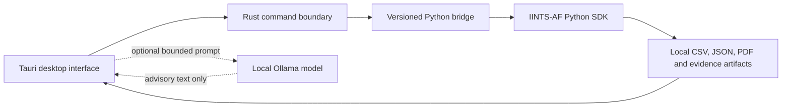
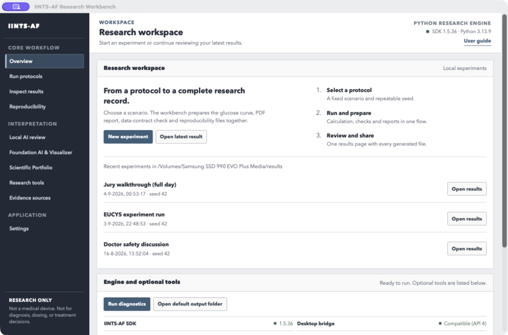
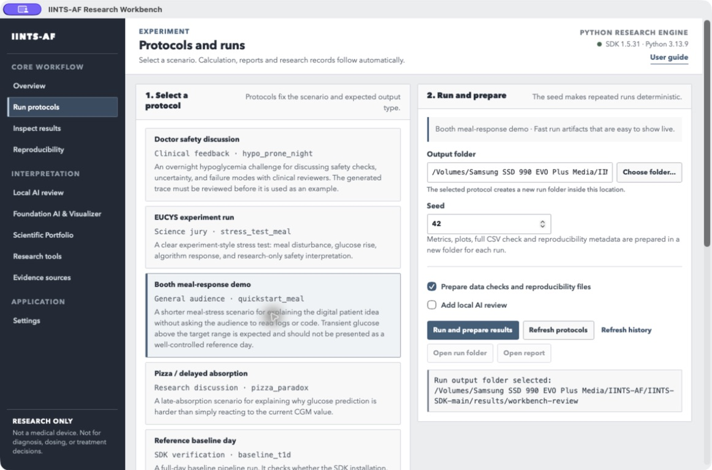
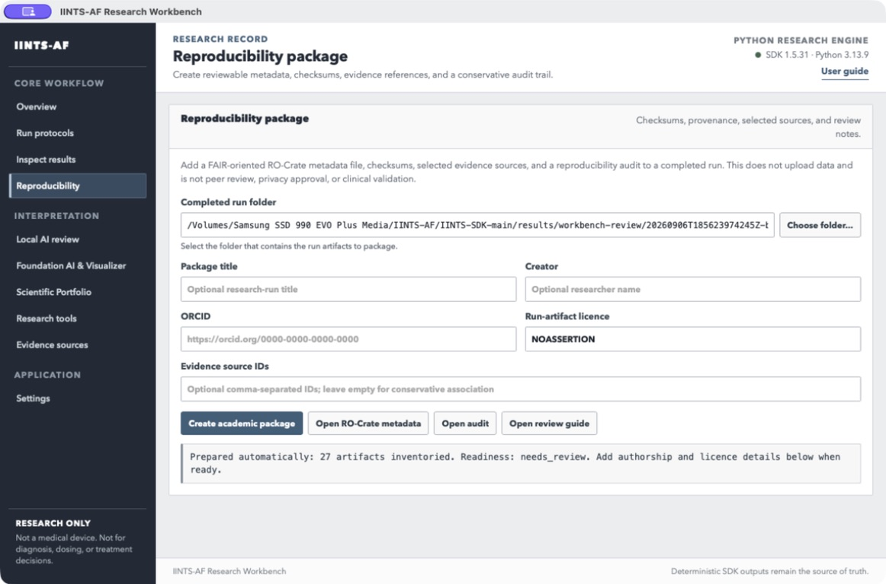
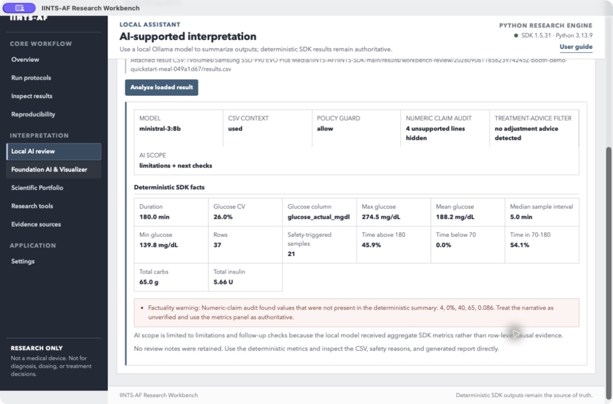
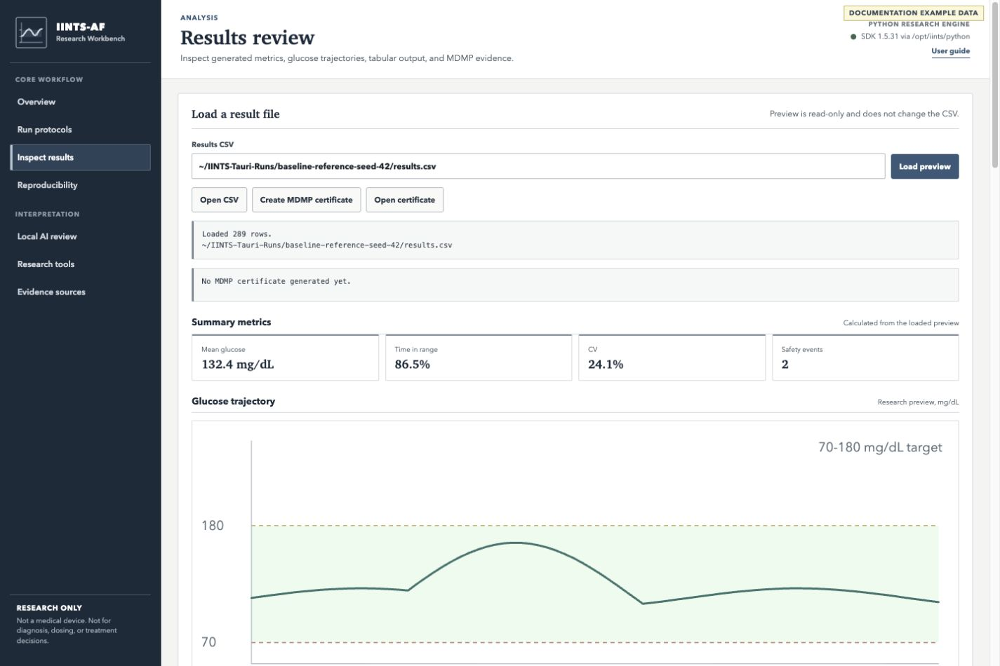
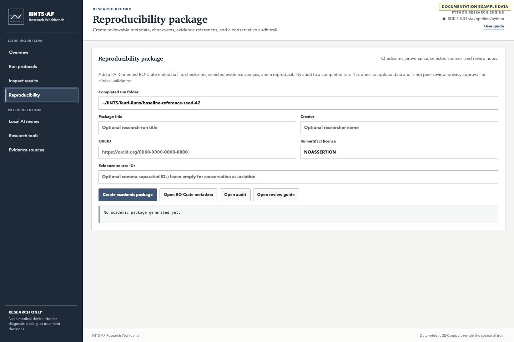
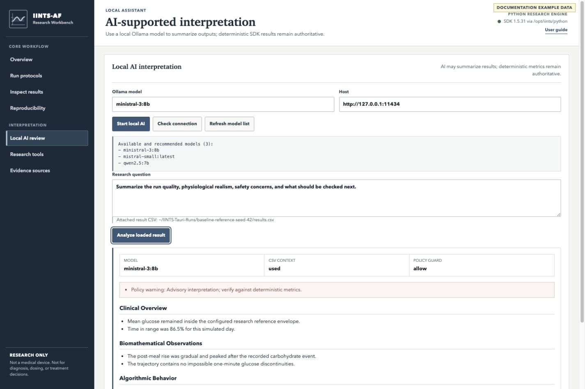
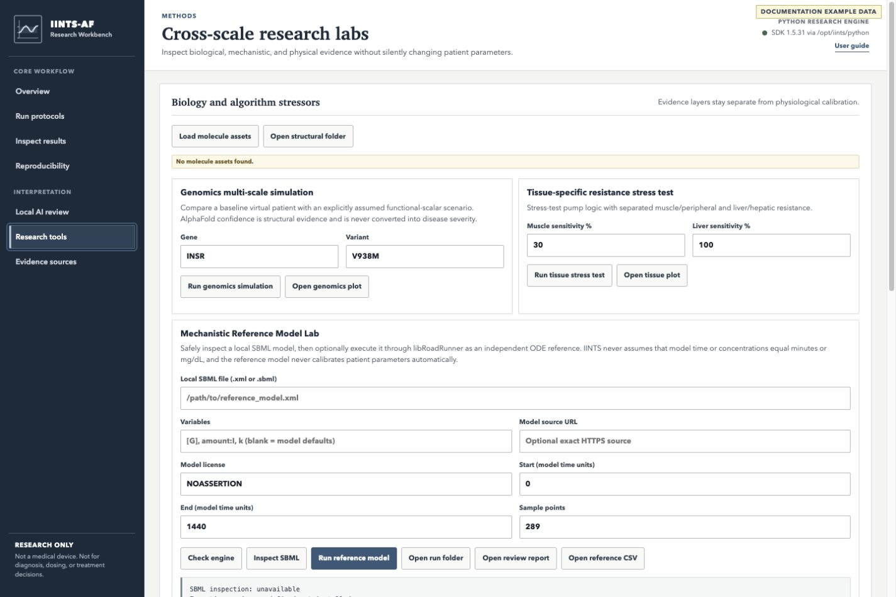
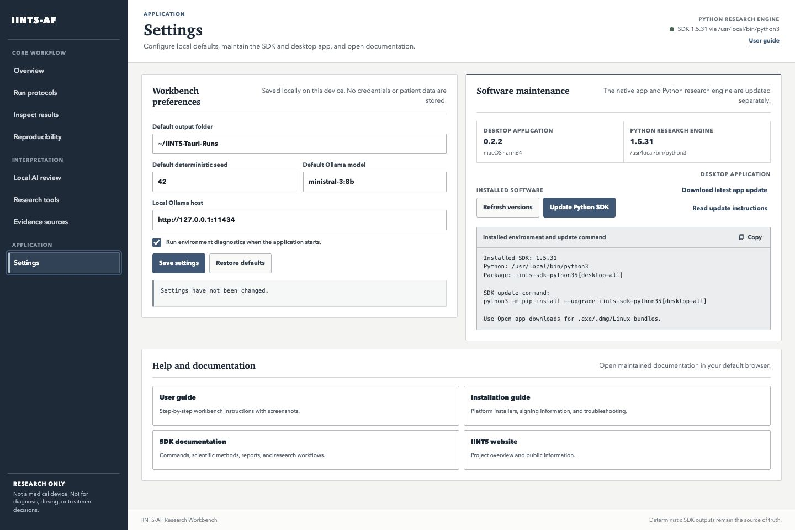

# Research Workbench User Guide

**Liever eenvoudige uitleg in het Nederlands?** Lees de [app-wegwijzer: wat doet alles?](APP_WEGWIJZER_NL.md), met uitleg per scherm, knop en invoerveld.

The IINTS-AF Research Workbench is the native desktop interface for the Python SDK. It helps you run a protocol, inspect its outputs, create reproducibility evidence, and request a local AI review without reimplementing scientific logic in the app.

!!! warning "Research scope"
    IINTS-AF is research and education software. It is not a medical device and must not be used for diagnosis, insulin dosing, treatment decisions, or real-time patient care.

!!! info "About the screenshots"
    Screenshots in the automatic-workflow section were captured from the native macOS app during a real **simulated** booth protocol. Other screenshots use labelled documentation fixtures. Neither is clinical validation evidence. The automatic workflow requires a Python engine advertising `automatic_run_bundle`; update both components if these options are unavailable.

## What The App Is

The workbench is a controlled interface around the SDK, not a second simulation engine. Its layers are deliberately separated:



- **Tauri interface** provides navigation, native file selectors, charts, and status messages.
- **Rust boundary** validates commands and paths before starting the fixed Python bridge.
- **Python SDK** owns simulations, deterministic metrics, data contracts, and report generation.
- **Local files** remain the reviewable source record. The interface does not rewrite result data.
- **Ollama** may explain a loaded result, but it cannot replace deterministic calculations or authorize a dose.

This separation matters when citing results: record the Python SDK version and run metadata, not only the desktop-app version.

## Install And Open

Use the current native beta installer for your platform:

| Platform | Installer |
| --- | --- |
| Windows | [Download `.exe`](https://github.com/python35/IINTS-SDK/releases/download/tauri-beta-latest/IINTS-AF-Research-Workbench-windows-x64-setup.exe) |
| macOS | [Download `.dmg`](https://github.com/python35/IINTS-SDK/releases/download/tauri-beta-latest/IINTS-AF-Research-Workbench-macos.dmg) |
| Linux | [Download `.AppImage`](https://github.com/python35/IINTS-SDK/releases/download/tauri-beta-latest/IINTS-AF-Research-Workbench-linux-x64.AppImage) |

The native app delegates calculations to the Python SDK. If Overview reports that the Python engine is unavailable, select **Install Python engine**. The same action is available under **Settings → Install or update Python SDK**.

The app opens a terminal with a fixed Rust-owned command, creates a private engine at `~/.iints-af/python-engine`, and installs the supported SDK dependencies there. After completion, return to the app and select **Refresh versions**. This avoids relying on the limited `PATH` inherited by a macOS Finder launch and does not modify an unrelated project environment.

Python `3.10` through `3.14` must be available on the computer. The [installation guide](APP_INSTALL.md) includes a manual fallback when automatic discovery cannot find it.

### First-run checklist

1. Open **Settings** and choose a default output folder.
2. Select **Install or update Python SDK** if the Overview cannot find a compatible engine.
3. Return to **Overview** and select **Run diagnostics**.
4. Confirm the SDK and Python versions before generating research artifacts.
5. Start with **Reference baseline day** as an installation/reporting check, or use the shorter booth meal-response demo for interface practice.

### Native interaction

The installed app deliberately behaves like a desktop workbench rather than a website:

- labels, navigation, and buttons cannot be accidentally selected or dragged
- inputs, logs, AI answers, result values, and tables remain selectable for research work
- the browser context menu is suppressed outside those copyable data areas
- scientific charts appear immediately without decorative drawing animations
- embedded browser developer tools are disabled in the packaged application
- folder and model/result locations use native macOS, Windows, or Linux selectors; paths remain
  editable for advanced reproducibility workflows

Use <kbd>Ctrl</kbd>/<kbd>Cmd</kbd>+<kbd>O</kbd> to open the result-file selector and
<kbd>Ctrl</kbd>/<kbd>Cmd</kbd>+<kbd>,</kbd> to open Settings.

These interface rules do not restrict access to generated artifacts; files remain available in the selected output folder.

## The Normal Workflow

Use the left navigation in this order:

1. **Overview** — verify the local engine and optional tools.
2. **Run protocols** — choose a protocol, output folder, and deterministic seed.
3. **Inspect results** — review metrics, the glucose trace, and CSV rows.
4. **Reproducibility** — inspect the automatically created package; add authorship and licence details if appropriate.
5. **Local AI review** — optionally ask Ollama to summarize the loaded result.
6. **Foundation AI & Visualizer** — pretrain or inspect the independent GlucoFM-method reproduction.
7. **Scientific Portfolio** — assemble only the local evidence files that actually exist.
8. **Research tools** — use independent biology, equation-model, or device-physics tools.
9. **Evidence sources** — inspect connector status and open official resources.
10. **Settings** — save local defaults, check versions, update software, and open help.

## 1. Check The Environment



Select **Run diagnostics** before a new experiment. A normal ready environment shows:

- the installed IINTS-AF SDK version
- the Python version used by the app bridge
- whether an Ollama command was found and whether its local service/model is ready
- readiness of optional modules such as MDMP, Plotly, libRoadRunner, and FMPy

Missing optional modules do not always block a normal simulation. They only block the feature that depends on them.

The Ollama command and the Ollama service are separate checks. On macOS the application may find Ollama inside `/Applications` even when a Finder-launched app does not inherit a terminal `PATH`. The Local AI page performs the service and model check.

Equivalent terminal check:

```bash
iints doctor
python -c "import iints; print(iints.__version__)"
```

## 2. Run A Protocol



1. Select one protocol in the left panel.
2. Select **Choose folder...** and choose an output location you can archive later.
3. Record the seed. The default `42` is suitable for a reproducible first run.
4. Leave **Prepare data checks and reproducibility files** enabled. Add **local AI review** only if you want it.
5. Select **Run and prepare results**. The results page opens automatically after preparation.
6. Review the per-stage status. An optional step can fail without discarding the successful simulation.

Do not compare runs unless their protocol, SDK version, patient profile, time step, and seed policy are recorded.

### Automatic preparation and reopening

Every run receives a new timestamped directory; repeating a protocol does not overwrite the previous experiment.
The standard flow prepares the following from the actual simulation output:

| Step | Output | What it means |
| --- | --- | --- |
| Simulation | CSV, PDF and run configuration | The SDK computes the trajectory; the UI does not invent it. |
| Result review | Glucose figure and `desktop_metrics.json` | Metrics use the full CSV, not only the rows displayed in the table. |
| Data contract | Signed MDMP certificate, report and public key | A full-file schema/completeness check, not clinical validation. |
| Optional local AI | `local_ai_review.md` and JSON | Advisory interpretation; may fail or be filtered without invalidating the simulation. |
| Research record | `ro-crate-metadata.json`, `academic_audit.json`, `ACADEMIC_BUNDLE.md` | Checksums and provenance; authorship and licence may still need review. |


The most-used files are shown first. Expand **Data checks and supporting files** for certificates,
configuration and metadata. Expand **All metrics and column information** for technical details.
Use **Open latest result** on Overview, or a history entry, to reopen an experiment without rerunning it.
Changing the output folder reloads its own history. Changing a CSV clears the old review context;
previously prepared checks are not restored if the file's SHA-256 has changed.

`OPEN_FIRST.md` is the run's entry point outside the app. `desktop_run_bundle.json` records final
preparation status and paths, including warnings. Files remain on disk if an optional exporter fails.
A saved intermediate preparation state is marked as interrupted rather than presented as complete.

The signing private key stays in `~/.iints-af/keys/mdmp`, outside the shareable run folder.
Only the public verification key accompanies the certificate. Review files and data permissions before sharing.



### Recorded physiology map

Use **Inspect results → Compartment model → Physiology map** for a compact pathway overview.
The adjacent **Diagram** tab retains the detailed state/flux schematic.


This is **not a 3D anatomical reconstruction**. It presents selected relationships from the loaded model:

- **Plasma glucose** is a concentration; the box is not a heart model.
- **Endogenous production** uses the model's actual recorded EGP term, including Bergman's `basal_production`. It is not stored liver glycogen.
- **Meal absorption** shows the recorded glucose-appearance rate with its source units.
- **Subcutaneous insulin** shows an identified insulin depot, not a glucagon depot or total insulin on board.
- **Glucose disposition** distinguishes Bergman's lumped disappearance term from peripheral exchange when the loaded schema provides it. It does not invent a separate muscle mass.

Select a box to inspect its recorded states or equation. The explanation appears **below** the map,
not on top of other values. Expand **All recorded flow values at this time** for the complete recorded list.
The overview intentionally omits some pathways; it is not a complete mass-balance diagram.

Values snap to a recorded sample and show its time/index. Playback moves the time cursor only;
there are no decorative flow particles. Arrows reverse for negative signed rates, have no arrowhead
at zero, and disappear for unrecorded channels. Width is constant and does not compare incompatible units.
A value inside 70–180 mg/dL is labelled **in range**, not **stable**; a single value cannot establish stability.

### Optional local review

The run preference uses the Ollama model/host selected in Settings. The automatic run step does not
silently download models or start remote services. Use **Local AI review → Start local AI** to prepare
Ollama first; this can involve a model download. Without a ready model, the run retains its artifacts
and records a warning for that optional step.



Numeric-claim and advice filters may remove all narrative notes. In that case the app says so and
keeps the deterministic metrics visible. A successful LLM request is not verification of physiological realism.
In **Settings → After each run**, save automatic preparation/review defaults for future runs.

### Curated protocols

| Protocol | Intended use | Interpretation boundary |
| --- | --- | --- |
| Doctor safety discussion | discuss an overnight low-glucose challenge with a clinical reviewer | a simulated challenge, not a treatment recommendation |
| EUCYS experiment run | demonstrate a meal-stress experiment and its recorded safety events | evidence for the software experiment, not clinical effectiveness |
| Booth meal-response demo | short public explanation of a meal response | target-range excursions are intentional; this is not a controlled reference day |
| Pizza / delayed absorption | inspect delayed meal dynamics and forecasting uncertainty | a scenario assumption, not a universal pizza-response model |
| Reference baseline day | verify installation, reports, and artifact generation | an SDK baseline, not a clinically validated reference trace |
| Jury walkthrough (full day) | review a 24-hour, five-minute-step example with evidence artifacts | remains simulated and must be presented with its limitations |

The run button is disabled while the SDK process is active. Cancelling stops the child process and records the cancellation in the visible status; it does not mark a partial folder as a completed run.

The app calls the same SDK engine used by CLI workflows. A typical command-line equivalent is:

```bash
iints presets run \
  --name realistic_reference_day \
  --algo algorithms/example_algorithm.py \
  --seed 42 \
  --output-dir results/reference_day_seed_42
```

The exact equivalent command can differ by curated desktop protocol. Treat the generated run configuration as the authoritative record.

## 3. Inspect Results



After a desktop protocol completes, the app loads its `results.csv` automatically. To inspect an
existing run, select **Choose CSV...**, choose the local file; its preview loads automatically. If you edit the path manually, select **Load preview**.
Advanced users may still edit the displayed path directly.

Review these parts together:

- **Result status** — confirms the file and row count that were loaded.
- **Summary metrics** — compact orientation metrics, not a complete analysis.
- **Glucose trajectory** — a bounded visual preview with the configured 70–180 mg/dL reference band.
- **Tabular preview** — a bounded selection of rows from the source CSV; it is not the full dataset.
- **MDMP certificate** — data-contract checks for the selected CSV.

The **Diagram** view shows model states and declared fluxes. The **Physiology map** provides a model-aware overview of selected pathways with recorded values and a non-overlapping detail panel. See the map instructions above for its limits.

The historical MDMP label `clinical_grade`, when encountered in an artifact, means that the strongest implemented **data-contract** checks passed. It does not mean that the physiology, cohort, model, or result has been clinically validated.

The preview is read-only. It must not silently interpolate, repair, or overwrite the source CSV.

Useful CLI checks:

```bash
iints report --results-csv path/to/results.csv --style agp
iints data certify data_contract.yaml path/to/results.csv --quick
```

Read [Understand A Run](RUN_OUTPUTS.md) before using a preview as evidence in a study.

## 4. Create A Reproducibility Package



Open **Reproducibility** after loading a completed run.

1. Confirm the completed run folder or select **Choose folder...** to locate one.
2. Add a descriptive package title.
3. Add the researcher name and ORCID when appropriate.
4. Leave the run-artifact licence as `NOASSERTION` unless you know which licence applies to every exported artifact.
5. Add explicit evidence source IDs only when those sources support the run.
6. Select **Create academic package**.

The package stays local. It adds RO-Crate metadata, checksums, a source snapshot, and an audit report. A successful export is not peer review, privacy approval, or clinical validation.

Equivalent CLI command:

```bash
iints research academic-bundle path/to/completed_run
```

See [Academic Research Workbench](ACADEMIC_RESEARCH_WORKBENCH.md) for artifact definitions.

## 5. Use Local AI Review



Local AI is optional and advisory.

1. Open **Local AI review**.
2. Select or type an Ollama model name.
3. Keep the host at `http://127.0.0.1:11434` for a local server.
4. Select **Start local AI**. The app starts Ollama when possible and prepares the selected model.
5. Confirm that the correct result CSV is attached below the question.
6. Write a focused research question.
7. Select **Analyze loaded result**.

The answer is separated into model metadata, policy status, warnings, headings, and lists. Verify every numerical or physiological claim against deterministic SDK outputs. Prompt instructions alone are not trusted: the Python bridge also hides lines containing unsupported quantities or treatment-adjustment suggestions before the app renders them. The metadata reports both filters.

Example questions:

```text
Which deterministic metrics should I inspect before accepting this run as realistic?
```

```text
Summarize the glucose pattern, list possible simulation artifacts, and identify claims that cannot be supported by this CSV alone.
```

Do not ask the model for dosing or treatment advice. Read [AI Safety Gates](LOCAL_AI_SAFETY_GATES.md) for the enforced boundaries.

## 6. Use Foundation AI

The **Foundation AI & Visualizer** workspace is for CGM-representation research. It implements an independent, paper-aligned reproduction of the GlucoFM v2 method; it does not bundle or claim to be the official Google model or weights.

### Pretrain a local reproduction

1. Choose a multi-subject CGM CSV, TSV, or Parquet dataset.
2. Choose an empty or dedicated output folder.
3. Set epochs and batch size for the available hardware.
4. Select **Pretrain local reproduction** and preserve its resolved configuration and logs.

Subject-separated data and sufficient observations per subject are required for meaningful evaluation. A completed training process is not evidence of generalization.

### Inspect a trained representation

1. Choose a measured 24-hour CGM CSV.
2. Choose a locally trained `glucofm_encoder.pt` checkpoint.
3. Specify column names only when automatic detection is incorrect.
4. Select **Extract trained 128D embedding**.

The embedding chart is populated only from that checkpoint-backed operation. **Compare selected evidence** accepts comparable evaluation JSON artifacts; it does not compare arbitrary files as if their cohorts and protocols were equivalent. The Clarke chart states whether it shows held-out evidence or a fixed-seed demonstration.

## 7. Build A Scientific Portfolio

The **Scientific Portfolio** workspace creates a local dossier index from evidence already present on the computer.

1. Choose a dedicated dossier output folder.
2. Select **Generate evidence dossier**.
3. Read the status summary and note every skipped or missing figure.
4. Open the dossier and manifest, then verify captions, source paths, cohorts, units, and licences before sharing.

The generator does not invent missing figures or convert absent validation into a positive claim. A dossier is a review aid, not peer review, statistical significance, clinical validation, or regulatory approval.

## 8. Use Research Tools



The **Research tools** workspace contains independent evidence and stress-test layers:

| Tool | Use | Important boundary |
| --- | --- | --- |
| AlphaFold assets | inspect protein structure and PAE confidence | confidence is not disease severity |
| Genomics stressor | compare an explicit functional-scalar scenario | unknown variants are not assigned an effect automatically |
| Tissue resistance | separate muscle and liver sensitivity assumptions | a stress test is not patient calibration |
| SBML/libRoadRunner | execute an independent equation model | external units are not assumed to be mg/dL or minutes |
| COPASI | inspect sensitivity and identifiability tasks | configured tasks and bounds require review |
| OpenCOR/CellML | validate an independent physiology model | imported models remain separate evidence |
| FMI/FMPy | inspect or run reviewed device-physics models | FMUs can contain native code and require explicit trust |
| BindingDB | retrieve measured affinity records | Ki, Kd, IC50, pLDDT, and in-vivo effect are distinct evidence types |

Start with **Check all engines**. Open only the lab you need, and preserve the generated evidence bundle with the study record.

Use **Choose file...** beside SBML, COPASI, CellML, or FMI inputs. The native selector filters the
visible files by the expected extension. Selecting a file never executes it: static inspection and
explicit execution remain separate actions, and COPASI/FMI execution still requires the relevant
confirmation checkbox.

### Inspect an AlphaFold structure

Each bundled protein card provides separate actions with different evidence meanings:

1. **View 3D** opens a local, interactive C-alpha backbone in the app. Drag to rotate, scroll to
   zoom, or use the arrow keys. Colours represent AlphaFold pLDDT confidence.
2. **Open PNG** opens the bundled static render.
3. **Reveal mmCIF** shows the exact local coordinate file in Finder, Explorer, or the Linux file
   manager rather than relying on an operating-system association for `.cif`.
4. **Generate PAE** retrieves the official AlphaFold Predicted Aligned Error data over verified
   HTTPS and writes an interactive HTML artifact below the selected output folder.
5. **AlphaFold entry** opens the matching official database page in the system browser.

pLDDT describes local structure-prediction confidence and PAE describes confidence in relative
residue placement. Neither value is converted into pathogenicity, insulin sensitivity, disease
severity, or treatment logic.

## 9. Evidence Sources

The **Evidence sources** workspace describes whether a connector is:

- **Integrated** — the SDK can retrieve or generate a bounded evidence artifact.
- **Partial** — only part of the workflow is implemented.
- **Portal** — the app opens the official external resource.
- **Planned** — no functioning integration exists yet.

Opening a portal does not import its content into a simulation. External evidence must be cited, reviewed, licensed appropriately, and connected to a claim explicitly.

## 10. Configure And Maintain The App



Open **Settings** to maintain the workbench without mixing application controls into a scientific run.

### Local preferences

You can set:

- the default output folder, selected with **Choose folder...**
- the default deterministic seed
- the default local Ollama model
- the local Ollama host
- whether diagnostics run at startup

Select **Save settings** to apply these values to the Run and Local AI workspaces. Preferences are stored only in the app's local browser storage. The Settings panel does not store tokens, passwords, patient data, or run results. Ollama hosts are restricted to `localhost`, `127.0.0.1`, or `::1`.

### Software updates

The desktop app and Python SDK have separate version records:

- **Install or update Python SDK** creates, repairs, or updates the private app engine through a fixed, Rust-owned command. The app does not accept arbitrary shell text.
- **Check for app update** queries the signed Tauri update manifest. When a newer signed build is available, **Install update & restart** downloads, verifies, installs, and relaunches it.
- **Download manually** opens the newest versioned beta release as a fallback when the native updater cannot complete.
- **Refresh versions** compares the native app with versioned GitHub beta releases and the Python SDK with the stable PyPI release. The two components are never treated as one version.

Successful checks are cached for six hours. When release services are unavailable, the app labels the result as unverified or uses clearly identified stale cache data; it does not claim that an unknown version is current. A separate warning appears when active Python source code and installed package metadata disagree.

The updater never installs an unsigned payload: the downloaded artifact must match the public key embedded in the application. Updates are user-initiated and progress is visible. On macOS, place the app in a writable location such as `/Applications`; running it directly from a read-only disk image prevents replacement. The Python SDK is maintained separately because changing the scientific engine must not be confused with changing the interface.

### Help

The same workspace links to this user guide, installation troubleshooting, the complete SDK documentation, and [iints.org](https://iints.org/).

## Common Problems

| Message or symptom | What to do |
| --- | --- |
| Python bridge unavailable | select **Install Python engine**, wait for completion, then select **Refresh versions** |
| `No module named iints_desktop` | repair the private engine with **Install or update Python SDK**; the discovered Python does not contain the SDK bridge |
| Protocol list is empty | run diagnostics, verify the SDK installation, then select Refresh protocols |
| Native selector does not open | confirm you are using the installed app rather than a browser preview |
| CSV preview fails | select the file again with **Choose CSV...** and confirm it is a supported results CSV |
| Ollama command not found | install Ollama once; on macOS keep the app in `/Applications`, then run diagnostics again |
| Ollama command found but service unavailable | open Local AI and select **Start local AI**, then run **Check connection** |
| A run, report, test, or update fails with `No space left on device` | check free space on both the selected output volume and the operating system temporary volume; large jobs may still use temporary files even when results are stored on an external disk |
| Model is missing | choose Refresh model list or allow Start local AI to pull the selected model |
| Optional research engine missing | install or configure only the engine required for that lab |
| macOS blocks the beta | follow the signed-build and Gatekeeper guidance in [Desktop App Installation](APP_INSTALL.md) |

## Keep A Reviewable Record

For every result you intend to discuss or publish, preserve:

```text
run-folder/
├── results.csv
├── config.json or run metadata
├── clinical or research report
├── safety and audit events
├── MDMP artifacts when used
└── academic_bundle/
    ├── ro-crate-metadata.json
    ├── checksums
    └── academic audit
```

The interface is a workbench, not the scientific authority. The Python SDK output, recorded configuration, deterministic checks, and source evidence remain the basis for interpretation.

## Updating an installed Tauri workbench

In **Settings**, check for an app update, then choose to install the offered
version. The workbench downloads and verifies the signed update and restarts.
You normally do not need to download another DMG or EXE manually. Finish running
jobs first; Windows may display an installer or permissions prompt. On macOS,
install the app in a writable location rather than running it inside the DMG.

The **Python SDK is a separate update**: use **Install or update Python SDK** and
then refresh versions. Beta 0.2.14 needs SDK 1.5.37 for automatic results
preparation. Older engines retain the basic workflow and show an update hint.
In-app updater signatures do not replace Apple notarization or Windows signing.
The older PySide desktop app cannot update into Tauri through this mechanism.
